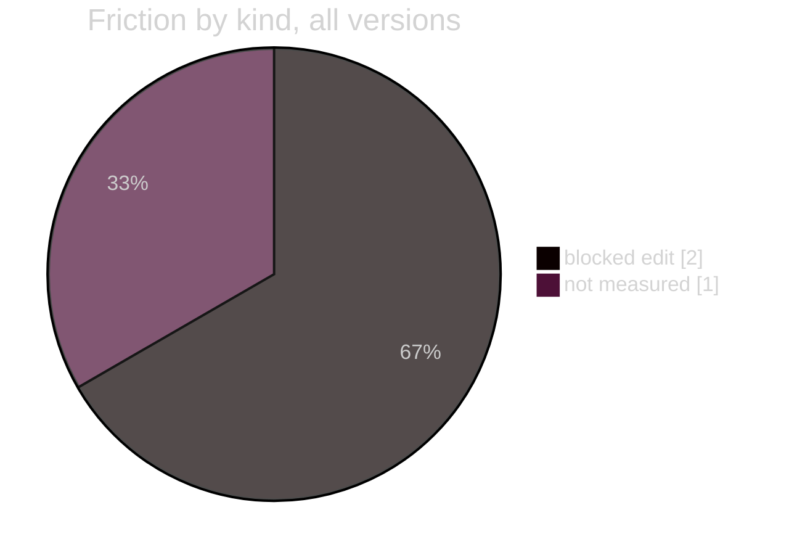

# 02 · The goal, and how far we are, without sugar
**For:** the human · **By:** Claude Fable 5.1 (for Amit Malhotra) · **Date:** 2026-10-25 · **Record:** iteration v0.1.0 · back to [00_START_HERE](00_START_HERE.md)
*Template for any project: `the goal and the distance` (the goal restated, the finish lines, the slip catalog, a scorecard per management function) · fills from: the friction logs, the rules ledger, the roadmap's P2 table · 📏 = measured by code · 🧠 = the reviewer's judgement. Only the numbers are this project's; the sections are the same in every project.*

> 🎧 **In one breath:** The goal is a résumé, LinkedIn profile and application kit for a Forward Deployed Engineer target, every line traceable to a verified fact about the human's own projects. The documents exist and are exported; what is missing is the human's read-through, six projects still described second-hand, and a test of the outward files that code can run.

**The numbers:** the slip catalog's counts come from the friction logs at 2026-10-25 14:39; the stage percentages are 🧠 estimates, the previous review's beside today's.

## 1. The goal, restated (correct any line)
- 📏 The config has no `goal` line; the human's words stand in.
- The human, 2026-10-25: "check all the previous model's work for thoroughness, fill shortcomings, build high-quality resume, LinkedIn and job-application content."
- The human, 2026-10-25: "Go through each ENTIRE project (read recent .md or else the code; no shortcuts)."
- The human, earlier the same day: position as a Forward Deployed Engineer for full-time and 1099 work; "AMTrix" never shortened; no n8n; "modular instruction design" not "prompt engineering"; the Lego-piece principle everywhere.
- 🧠 Suggested `goal` line: "A verified, two-page FDE résumé, LinkedIn profile and application kit, rebuilt from full reads of every project, with exports a recruiter can open."

## 2. Three finish lines
| Stage | What "done" looks like | Previous review 🧠 | Today 🧠 | What is missing |
|---|---|---|---|---|
| **Stage 1 · the set exists** | Résumé, LinkedIn, kit and dossier rebuilt from the notes, exported to PDF and DOCX, with no banned phrasing | no previous review | **~85 %** | the human's read-through and the close of request #1 ([08](08_DECISIONS.md) D); a code-run check of the outward files ([16](16_PRIORITIES.md) row 1) |
| **Stage 2 · every fact first-hand** | All twenty-one project sections read in full by this pass, the six second-hand ones re-verified and the outward set updated | no previous review | **~70 %** | folder access for the six ([08](08_DECISIONS.md) C; [14](14_EXTERNAL_DEPENDENCIES.md) §4); the three deferred counts |
| **Stage 3 · in use** | The résumé is sent against real postings and cover letters are tailored per posting; every repository stays private (corrected v0.1.4: the human, "do not make anything public") | no previous review | **~15 %** | the GitHub link kept or dropped ([08](08_DECISIONS.md) B); the token and key rotation in the source projects as private hygiene (final report §4, outside this repo) |

*Estimates. The counts below are measured.*

## 3. The slip catalog, today (📏 the counts; 🧠 who catches each)
| Kind | All versions | Last 2 days |
|---|---|---|
| blocked edit | 2 | 2 |
| not measured | 1 | 1 |

📏 15 of 15 rows marked as code · 192 obligations in the rules ledger

| Kind | Who catches it today | By code? | What would catch it by code |
|---|---|---|---|
| blocked edit | the PreToolUse hook (`hook`): no open iteration, and a write outside the project | ✅ | already by code; both lines are the guard working, not a slip |
| not measured | `finish` prints the warning and closes partial | 🟡 | a `test_suites` entry pointing at a real check of the outward files ([16](16_PRIORITIES.md) row 1); until then the warning repeats at every close |
| my slip (2 lines, logged after the 📏 count) | the model's own reading, after the fact | 🔴 | a terminal edit of a project file cannot be seen by the edit hook; `check` after a shell edit is the rule, and a test that diffs the hook's backups against the files would show an unbacked change (a standard request, outside this repo) |

📏 From the counts above: 1 kind caught by code, 1 partly, 1 by nobody, 0 outside

## 4. Scorecard per management function
| Function | Grade 🧠 | What exists 📏 | What is missing |
|---|---|---|---|
| Planning | 🟢 A | two plans with Kind, Requests, Size, ten sections and acceptance commands; `new` refused nothing | a `goal` line in the config so 02 §1 is measured, not quoted |
| Approval | 🟢 A | two `approve --said` lines in the human's words; edits refused before the first (friction: blocked edit) | nothing; the standing yes covered the loop's own calls |
| Building | 🟡 B | every outward file edited through the tool with a backup, except two `sed` lines and one heredoc (11 §3) | the habit: `check` after any shell edit, no shell edit of a project file at all |
| Proof | 🔴 D | three acceptance commands pass; no test suite, so "count not reported" and no green close | a `tests/` check the project owns ([16](16_PRIORITIES.md) row 1) |
| Record | 🟢 A | 19 record files, four per iteration, locked at finish; 0 stale living docs; the friction log has every refusal | git, so the record is also committed |
| Review | 🟡 B | this folder, 85 holes filled in the same session the work closed | a second reviewer model (today the reviewer and the worker are the same model) |

## 5. Bottom line
🧠 Stage 1 is a read-through away from done: the files exist, export cleanly and pass the banned-phrase checks, and only the human's word on request #1 is missing. Stage 2 waits on one macOS permission dialog, after which a session can re-read the six second-hand projects and the outward set stops carrying a "not re-verified" note.
