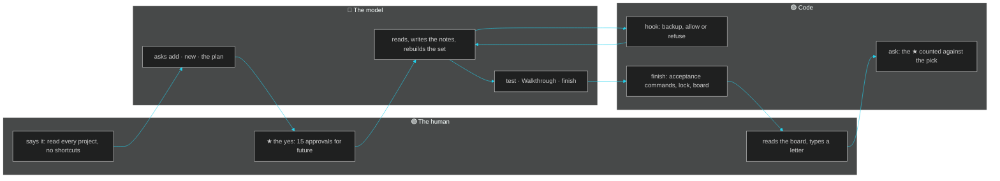

# 03 · The model thinks, the structure decides the shape: how much is each today
**For:** the human · **By:** Claude Fable 5.1 (for Amit Malhotra) · **Date:** 2026-10-25 · **Record:** iteration v0.1.0 · back to [00_START_HERE](00_START_HERE.md)
*Template for any project: `prompt rules vs code` (the aim, who does what, the rules inventory, the patterns, what stays with the model, the loop) · fills from: the roadmap's P2 table · 📏 = measured by code · 🧠 = the reviewer's judgement. Only the numbers are this project's; the sections are the same in every project.*

> 🎧 **In one breath:** Almost all of this project's discipline is the standard's code: the hook refused edits before an approval existed, the stamp dated every changed file, and finish ran the acceptance commands and locked the record. What is still words is everything particular to a résumé portfolio: no "AMX", no n8n, no "prompt engineering", no quoted health detail, every claim traced to a notes line. Those rules live in the plan's section 5 and in the application kit's phrasing list, and only three of them are acceptance commands. A test suite the project owns would turn most of the rest into code in one script. The model's judgement stays where it belongs: which fact is résumé-worthy and how to phrase it.

📏 This file is about this project's own discipline: what its rules (its own CLAUDE.md, its tests: the tests) hold by code and what is still words. The P2 table in §3 is the standard's instrument, the same in every project: the frame, not the subject.

**The numbers:** the rules inventory is the roadmap's P2 table as it stood at 2026-10-25 14:39; the ledger's count of obligations held by code is on the board's audit row.

## 1. The aim, restated
- 2026-10-25, the human: "check all the previous model's work for thoroughness, fill shortcomings" — the aim is a record of what was verified, not a prettier document.
- 2026-10-25, the human: "Go through each ENTIRE project (read recent .md or else the code; no shortcuts)" — the method is full reads, with the notes file as the single source.
- 2026-10-25, the human: "15 Approvals for future" — the loop should run without a question per step once the series is approved.
- 2026-10-25, the human (this review): "provide suggestions for the working model and also provide any task for yourself and do it" — the review should produce work, not only findings.
- 🧠 The human wants the shape of the work fixed by the record (notes, then audit, then outward set) and the judgement left to the model inside that shape.

## 2. Who does what today
| Step | Who decides | The proof | Read |
|---|---|---|---|
| What is asked | the human | `asks add` with the human's words (request #1) | 🟢 logged once, in his words |
| What it means and how big | the model | the plan's **Requests** and **Size** lines (medium + medium) | 🟢 written before any edit |
| Whether to build | the human | `approve --said` (two lines in the record) | 🟢 the only yes that counts |
| The order | the model, within the plan | the Task file's one approved step; the notes before the outward set | 🟢 the plan's §2 names the order and why |
| How the edit is made | code | the PreToolUse hook: backup, then allow or refuse | 🟡 two `sed` lines and one heredoc went around it (11 §3) |
| Whether it worked | code | `finish`: acceptance commands and the suite | 🔴 no suite here, so only three greps decide |
| What the human sees | code | the footer board, the listen-along brief, the Walkthrough's Try it yourself | 🟢 pasted as printed at every reply |
| What the next model must know | the model, kept by code | the Walkthrough, the Resume block, the playbook's live pitfalls | 🟢 the model switch mid-day cost nothing |

## 3. The rules inventory today (📏 the roadmap's P2 table)
| Today (prose) | Becomes | Code |
|---|---|---|
| Write the approval line | `plan_hub.py approve --said "<your words>"` | ✅ |
| Restate + link | `plan_hub.py restate` (writes DIAGNOSTICS, prints the link) | ✅ |
| "Amit tested" | `plan_hub.py tested --said "<your words>"`, the only way it gets recorded | ✅ |
| Log every ask | State-line counter: "asks logged since your message: 0" | ✅ |
| A seen plan changes only through `next` | the edit hook refuses an edit to the open plan once it is approved or carries a comment thread of the human's (v0.27.9); `next "<why>"` records it and opens the revision | ✅ |
| Topic change question | `new` asks the deck question itself when it meets a plan already written (`NEW_REUSED`, v0.21.9, request #120) | ✅ |
| Options with ★ + brackets | `plan_hub.py ask` (v0.12.6): letters per question, numbered choices, `★ A1` the default, a bare "yes" = the defaults, the last letter opens the deck; it refuses padding | ✅ |
| A version closes with its docs current | `plan_hub.py close-version` (v0.13.3, request #63): every living doc updated or marked unchanged, dated; `bump` refuses while one is due, then writes the snapshot, the friction summary and the EVOLUTION line | ✅ |
| Make-or-break lines that name what to correct | v0.12.8–v0.13.2: rates over the last 10 closes and the last 7 days; a `next` revision is **revised**, not an early close; friction by hand carries its kind (`friction --kind`); `plan_hub.py test` runs the suites before `finish` records | ✅ |
| The board that ends every reply | `plan_hub.py footer` (v0.12.4): five lights with written triggers, five numbers, the top five, make-or-break, the parked requests, the links as names; `refresh` rebuilds it, the state line carries it, the model pastes it (design: `FOOTER_DESIGN.md`) | ✅ |
| The reply ends with the board, then ⏳ Waiting for you | v0.14.1: the Stop hook reads the reply's text and, once per turn, sends it back when the ending is missing; the board counts the misses | ✅ |
| Acceptance commands | `finish` refuses a plan without them (or records "none, Amit's words") | ✅ |
| The playbook's gotchas, remembered by the model | v0.15.6–v0.15.8 (request #81): refusals by code, `ASK_STALE` (an answer read twice or after a newer commit), `FINISH_REFUSED` (a finish after a red `test`), a Requests line of "none" ticks nothing, the board says "closed red" | ✅ |
| "Tests pass" in chat | The Stop hook sends a reply back once when it says tests pass while the approved step has no `finish` yet (`TESTS_CLAIM`, v0.20.9, request #121) | ✅ |
| Freeze | A feature iteration needs a friction line or your "new feature" (`finish` refuses a plan without a valid Kind line) | ✅ |

📏 15 of 15 rows marked as code

## 4. The four patterns, with today's examples
| Pattern | This version's example | What it replaced |
|---|---|---|
| A rule that became a verb | **"Approvals are recorded in the human's words"**: `approve --said` in v0.1.1 and v0.1.2 | a sentence in the plan saying "the human agreed" |
| A rule that became a refusal | **"No edit without an open approved iteration"**: the hook's `NO_OPEN_ITERATION` line at the start of v0.1.0 | the model remembering to open an iteration first |
| A rule that became a form | **"The plan has ten sections and an acceptance list"**: `new` wrote the skeleton; `finish` ran the list | a free-form plan in chat |
| A rule that stays a prompt line | **"No 'AMX', no n8n, no 'prompt engineering' in outward files"**: the plan's §5 and the kit's phrasing rules; only "AMX Plan" is an acceptance grep | nothing yet; it is the model's reading at every edit ([16](16_PRIORITIES.md) row 1 makes it a test) |
| A counter | **"reply endings missed 0 of 1 since v0.1.1"** on the board's P2 cell, and the state line's "requests logged since your message" | the human noticing a reply without its board |

## 5. What stays with the model (and should)
- **Which fact is résumé-worthy.** A grep can find "737 tests"; only a reader knows that "turned a data-loss incident into a backup-first CLI" is the stronger line for an FDE.
- **How to soften a claim honestly.** "Browser-session automation" instead of "bypasses bot protection" is a judgement about truth and audience, not a substitution table.
- **What is private.** The operator profile, trigger words and health details are recognisable by a model and not by a pattern; the rule "never quote them" needs reading.
- **Whether a project folder's silence is a blocker or a footnote.** Six unreadable folders became a flagged note rather than a halt; that call depends on how much the résumé leans on them.
- **When a slip is worth a friction line.** Code logs refusals; only the model can say "I went around the hook with sed" and log it.

## 6. What a smaller model would drop today
- **"Every outward claim traces to a notes line."** Refused by nothing; a smaller model would write a plausible bullet from memory and no check would notice.
- **"Never quote the operator profile or a health detail outward."** Refused by nothing; a grep for a few words would catch the obvious cases and miss paraphrase.
- **"Say 'used live with Claude Code; adapters for Codex and Antigravity', not 'all three agents'."** Refused by nothing; the first pass wrote the stronger claim and the second pass had to fix it.
- **"No shell edit of a project file."** Refused by nothing today; the hook cannot see a `sed`, and this model slipped twice.
- **"Type no test count or date into a doc."** Refused by nothing in the outward files; `finish` writes the record's numbers, but a résumé line can carry a typed count unchecked.
- **"Reply ends with the board, then Waiting for you."** Refused by the Stop hook, once per reply; this one holds for any model.

## 7. The pure human-in-the-loop, as one loop
```text
  THE HUMAN                     THE MODEL                          CODE
  ─────────                     ─────────                          ────
  "read every project,  ──►  asks add (his words)  ──────────►  the request, numbered
   no shortcuts"               new → the plan (Kind, Size, §7)    the skeleton, the hook armed
  ★ "15 Approvals"      ──►  approve --said ───────────────────►  the only yes; edits allowed
                              reads, writes the notes,            backup before each edit
                              rebuilds the résumé set             stamp after each edit
                              test → Walkthrough → finish ──────►  acceptance commands run,
                                                                    record locked, board rebuilt
  reads the board  ◄──────────────────────────────────────────────  footer, brief, ⏳ Waiting for you
  a letter on 08   ──►  ask --read ─────────────────────────────►  the pick counted against the ★
```

**What to look at:** the human's decision enters exactly twice, at the yes and at the letter; on the way back code checks the acceptance list, locks the record and counts whether the human's pick matched the model's star.
