# 06 · Roadmap check: where each phase stands, what the detour cost, the next ten
**For:** the human · **By:** Claude Fable 5.1 (for Amit Malhotra) · **Date:** 2026-10-25 · **Record:** iteration v0.1.0 · back to [00_START_HERE](00_START_HERE.md)
*Template for any project: `each phase's status` (the status block, the exit tests that are commands, what the roadmap did not foresee, the next ten iterations, what we will not do) · fills from: the roadmap doc, the board, the record · 📏 = measured by code · 🧠 = the reviewer's judgement. Only the numbers are this project's; the sections are the same in every project.*

> 🎧 **In one breath:** This project has no roadmap document, so its one request and the plan's own stages stand in for phases. Of those, two are done: the full re-read of the readable projects and the rebuilt outward set with its exports. One is half done: the facts, because six folders refused to open. One is reframed: "commit locally" became "no git here" and waits on the human. The next ten iterations are for proof first, then access, then use: a test the project owns, the six re-reads, and cover letters against real postings.

**The numbers:** the status block and the exit tests are measured at 2026-10-25 14:39; the phase lights, the detours' costs and the next ten are the reviewer's.

## 1. Where each phase stands (📏 the roadmap's own status block; 🧠 the status words)
no roadmap document; the requests stand in

- **open (1):** #1 Re-check the previous model's portfolio work for thoroughne…

| Phase | Status 🧠 | Evidence 📏 |
|---|---|---|
| Re-read every readable project in full | done | 3 second-pass blocks in `DATA_REFERENCES/DEEP_READ_NOTES_2026-10-25.md` (v0.1.1) |
| Audit the earlier model's work | done | 15 rows in `DATA_REFERENCES/AUDIT_OF_PRIOR_WORK_2026-10-25.md`, each fixed or marked unmeasurable (v0.1.1) |
| Rebuild the outward set | done | ATS résumé, LinkedIn, kit, dossier; 5 exports in `FINAL_RESUMES/exports/` (v0.1.1) |
| Every fact first-hand | blocked | 6 folders EPERM; the dossier's Verification Note ([08](08_DECISIONS.md) C) |
| The human's read-through and the close of request #1 | in progress | Requests: open 1 ([08](08_DECISIONS.md) D) |
| Commit the record | reframed | no git; `WARN NO_GIT` at finish ([04](04_SENIOR_REVIEW.md) W2) |
| A test the project owns | not started | Tests: count not reported ([16](16_PRIORITIES.md) row 1) |
| Repositories | private, by the human's rule | corrected v0.1.4: the human, "do not make anything public"; only the résumé's GitHub link is open ([08](08_DECISIONS.md) B) |

## 2. The exit tests that are commands (📏)
| Exit test | Today 📏 |
|---|---|
| Scripts over 1200 lines | none |
| P2 rules as code | 15 of 15 rows marked as code |
| Trust: changes to the standard in the window | 0 in 2 days (cap 20) |
| Replica drill | not applicable: no drill target configured (drill_target in amx_plan_config.json) |
| Requests open | 1 |

## 3. What the roadmap did not foresee
| Detour or surprise | Evidence 📏 | Cost | Where it goes |
|---|---|---|---|
| **macOS refused six folders.** `~/Documents/GitHub` returned EPERM for every folder outside the six readable ones, so a third of the projects stayed second-hand. | the notes' "not read" lines; the dossier's Verification Note | 0 iterations lost, 1 iteration owed (the re-read) | [08](08_DECISIONS.md) C; [16](16_PRIORITIES.md) row 4; [14](14_EXTERNAL_DEPENDENCIES.md) |
| **No git in the project.** The loop's last step has nowhere to go and finish skips the backup gate. | `WARN NO_GIT` at both finishes | 0 iterations; a standing warning | [08](08_DECISIONS.md) and [16](16_PRIORITIES.md) row 3 as the human's yes |
| **Two shell edits of the notes.** The model used `sed` for two one-line fixes, outside the hook. | 1 "my slip" friction line (14.41) | 0 iterations; 2 unbacked changes | a rule in [11](11_STRUGGLES_OF_THE_WORKING_MODEL.md) §5; the backup-diff check in [16](16_PRIORITIES.md) row 9 |
| **The review tag was the whole sentence.** `review-folder` refused it once. | 1 "my slip" friction line (14.41); `REVIEW_FOLDER_BAD_TAG` | one call | the playbook already says it; no row |
| **The model changed mid-day and the context compacted once.** Neither cost a round, because the record carried the state. | the Resume block; 2 iterations, 0 revised | 0 | a strength, [04](04_SENIOR_REVIEW.md) K5 |

## 4. The next ten iterations, in order
*This list is the work order for the working model after the frontier model's hard ones; the bundles follow the gauge (three easy of one area, a medium alone, a hard one never bundled). The rows are in [16](16_PRIORITIES.md); `review-jobs` turns them into requests on the human's word.*

*Corrected v0.1.4: row 1 was built as v0.1.3. The human then asked for this re-check, which took the label v0.1.4, so every later row moves one label down; the order stays.*

| # | Iteration | What | Size | Who | Exit |
|---|---|---|---|---|---|
| 1 | **v0.1.3 · the outward test** | a shell suite under `tests/` that checks the outward files, registered in `test_suites` | medium | working | `python3 amx_impl_plan/plan_hub.py test` prints a count and green |
| 2 | **v0.1.4 · config and export** | a `goal` and `project_name` line in the config; the export script moved inside as `scripts/export_resume.py` | easy + easy · area: project files | working | 02 §1 reads the goal by code; the exports rebuild from inside the project |
| 3 | **v0.1.5 · the human's two decisions** | close request #1 in the human's words; the GitHub link kept or dropped | easy | human | Requests: open 0; the header line of the résumé matches the decision |
| 4 | **v0.1.6 · the six re-reads** | after folder access, read PromptForge, SmartBrain, AMTrix Studio and the other three in full; update the notes | hard | frontier | 6 new second-pass blocks; the Verification Note shrinks to none |
| 5 | **v0.1.7 · the outward set updated** | carry the six re-reads into the résumé, LinkedIn, kit and dossier; re-export | medium | working | the test of v0.1.3 green; 2-page PDF still 2 pages |
| 6 | **v0.1.8 · cover letters per posting** | one letter per real posting from the kit's three variants, each traceable to the notes | easy + easy + easy · area: FINAL_RESUMES | working | each letter passes the outward test |
| 7 | **v0.1.9 · interview prep refresh** | STAR stories and the quick-reference card re-checked against the six re-reads | medium | working | no claim in INTERVIEW_PREP without a notes line |
| 8 | **v0.2.0 · the bump** | close the version with its living docs current | easy | working, the human's yes | `bump` writes the snapshot and the EVOLUTION line |
| 9 | **v0.2.1 · the second review** | a review folder by code, filled by a model that did not do the work | medium | frontier | 0 holes; 16's rows become requests |
| 10 | **v0.2.2 · security cleanups in the source projects** | rotate the leaked token and untrack the key files; every repository stays private (corrected v0.1.4) | hard | human | the final report §4 rows ticked |

```mermaid
%%{init: {'theme': 'dark', 'themeVariables': {'primaryColor': '#7c3aed', 'primaryTextColor': '#ffffff', 'primaryBorderColor': '#a78bfa', 'lineColor': '#22d3ee', 'secondaryColor': '#1e1e2e', 'tertiaryColor': '#313244'}}}%%
gantt
  title The next ten iterations, by who
  dateFormat X
  axisFormat %s
  section 🔵 working
    v0.1.3 the outward test        :a1, 0, 2
    v0.1.4 config and export       :a2, after a1, 1
    v0.1.7 the outward set updated :a5, after a4, 2
    v0.1.8 cover letters           :a6, after a5, 1
    v0.1.9 interview prep          :a7, after a6, 1
    v0.2.0 the bump                :a8, after a7, 1
  section 🟣 human
    v0.1.5 two decisions           :a3, after a2, 1
    v0.2.2 security cleanups       :a10, after a9, 3
  section 🟠 frontier
    v0.1.6 the six re-reads        :a4, after a3, 3
    v0.2.1 the second review       :a9, after a8, 2
```

## 5. What we will NOT do (on purpose)
- *(no roadmap document, so nothing carried)*
- **No edit to a source project from this repo.** The leaks and doc defects in the final report are the source projects' work; this repo only lists them, so one project never silently changes another.
- **No claim written from memory.** A project that cannot be read stays flagged; the résumé does not get a stronger line because the model recalls one.
- **No public repository, ever, without the human's own words.** Corrected v0.1.4: the human, "do not make anything public… don't you dare". No plan, row or deck star may propose it.
- **No "prompt engineering", no "AMX", no n8n.** The human's phrasing rules stand until the human changes them.
- **No reviewer who is also the worker, twice.** This folder was written by the working model; the next one is not.
