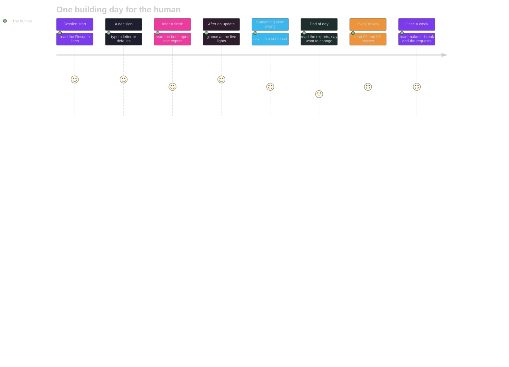

# 07 · The operating model: pure human in the loop
**For:** the human · **By:** Claude Fable 5.1 (for Amit Malhotra) · **Date:** 2026-10-25 · **Record:** iteration v0.1.0 · back to [00_START_HERE](00_START_HERE.md)
*Template for any project: `how the human runs it` (the loop, the human's minutes, the bars, the rituals tied to lights, the pick, the autonomy ladder, how you know it works) · fills from: the settings, the board · 📏 = measured by code · 🧠 = the reviewer's judgement. Only the numbers are this project's; the sections are the same in every project.*

> 🎧 **In one breath:** The human types a sentence of intent, a letter when a card asks, and one of the eleven slash words; nothing else is required. The hooks open the session with the Resume block, back up and gate every edit, stamp it, and send a reply back once when its ending is missing. On a building day that is about fifteen minutes of the human's time: a yes at the start, a board at each finish, a read-through at the end. The Tests light has no ritual here because it has nothing to measure; it is the one light that reads green without meaning it. The next rung is the one where a green finish needs a real test, and the project is one iteration away from it.

📏 This file is about how the human runs this project day to day: its code in its code, its tests (the tests), its own commands. The settings and the lights in §3, §4 and §7 are the standard's instruments, the same in every project.

**The numbers:** the bars, the lights and the cells are read from the settings and the board at 2026-10-25 14:39; the minutes and the targets are 🧠.

## 1. The loop (one cycle = one iteration)
| Step | Who | What happens | The verb |
|---|---|---|---|
| Words | the human | says what is wanted, in a sentence or a slash word | the UserPromptSubmit hook (`prompt`) adds the state line |
| The form | the model | logs the request in the human's words | `asks add --said` |
| The plan | the model | opens the iteration and writes Kind, Requests, Size, ten sections, the acceptance list | `new`, then the edit tool |
| The yes | the human | says yes once; the model records the words | `approve --said` |
| Build | the model | edits through the tool; every edit is backed up and gated | the PreToolUse hook (`hook`), the PostToolUse stamp |
| Prove | code | runs the suites and the acceptance commands | `test`, then `finish` |
| Show | the model, by code | the Walkthrough, the listen-along brief, the board | `finish` rebuilds the board; the Stop hook (`stop`) checks the ending |
| Commit | nobody here | no git in this project; the hook's backups are the only history | `WARN NO_GIT` at finish |
| Close | code | locks the four record files; the next `new` opens the next iteration | `finish` |

## 2. What you do, and how long it should take
| Moment | What you do | Minutes 🧠 | What the system did already |
|---|---|---|---|
| Session start | read the five Resume lines the model states | 1 | the SessionStart hook ran `resume` and wrote the board |
| A decision | type a letter, or "defaults" | 1 | `ask --json` built the card with a ★ and the brackets |
| After a finish | read the listen-along brief; open one Try it yourself | 3 | `finish` measured, locked, rebuilt the board and the brief |
| After an update | glance at the board's five lights | 1 | `refresh` rebuilt the footer; the Stop hook checked the reply's ending |
| Something seen wrong | say it in a sentence; the model logs it | 2 | `asks add` or `friction --kind "human feedback"` keeps the words |
| End of day | open the exports once; say what to change | 5 | the exports were rebuilt from the Markdown at the last finish |
| Every review | read 00, then 08; answer the questions | 10 | `review-folder` filled the measured sections; the reviewer the holes |
| Once a week | read the make-or-break lines and the requests list | 5 | `learned` and `footer` computed the rates |

## 3. The bars you set (📏 the settings today)
| Setting | Cell | Meaning | Value 📏 |
|---|---|---|---|
| trust_changes | Trust | changes to the standard allowed in the window | 20 |
| trust_days | Trust | the window of the trust rule, in days | 2 |
| features_week | Features this week | new features a week that need no extra yes | 20 |
| drill_goal | Replica drill | the share of checks a fresh model must match | 0.9 |
| drill_floor | Replica drill | under this share the cell is red | 0.8 |
| request_red_days | Requests | a request open longer than this turns the light red | 3 |
| job_red | Being fixed | open friction lines of one kind in the window that make it red and a job | 3 |
| job_days | Being fixed | the friction jobs' window, in days (unset: the trust window) | 2 |
| review_every | Review | version folders between two review folders written by code at the bump | 3 |

## 4. The rituals, each tied to a light (📏 the lights today; 🧠 the ritual)
| Light | Today 📏 | The ritual 🧠 |
|---|---|---|
| Record | 🟢 v0.1.1 closed | when yellow (an iteration open too long), say "finish" or "what is left"; when red, read the friction log's last line |
| Tests | 🟢 count not reported · 0 s · v0.1.1 | **no ritual yet: the light cannot turn red here because nothing is measured; once the suite exists, a red means "do not read the exports, say fix it first"** |
| Trust | 🟢 0 changes / 2 d | when yellow or red, ask what changed in the standard; here it should never move, since the standard is installed and never edited |
| Requests | 🟡 1 open, oldest 0 d | open the deck when a card is offered; say "done" in your words or "later"; red at three days means a request was never read back |
| Comments | 🟢 0 open | when yellow, the model has replied on the page; read the thread and say "resolved" or add a line |

## 5. The pick, made deterministic
- **By code at every refresh:** "Next up" sorts the open requests P1 first, then easy before medium before hard, then the older first; three easy of one area bundle, a medium goes alone, a hard one waits for the frontier model.
- **By code at the close:** `finish` ticks the requests named on the plan's Requests line when the acceptance commands and the suites pass; a failing command closes the iteration red, a missing suite closes it partial and logs "not measured".
- **Still a judgement:** which request is "the same area" as another, whether a résumé line is worth its space, and whether a flagged project should be re-read before or after the next posting; the model proposes, the human's letter decides.

## 6. The autonomy ladder
| Rung | What runs without the human | Entry rule | Today |
|---|---|---|---|
| 1 | nothing: every edit asks | the default of any tool | ✅ passed at install |
| 2 | edits inside an approved iteration | `approve --said` on record; the hook refuses the rest | ✅ since v0.1.0 |
| 3 | easy and medium work without a question per step | the standing yes ("15 Approvals for future") and the gauge | ✅ since v0.1.1 |
| 4 | a green finish means a real test passed | a `test_suites` entry with at least one check the project owns | 🟡 half: the acceptance commands run, no suite ([16](16_PRIORITIES.md) row 1) |
| 5 | the work order picks the next bundle by code | 16's rows turned into requests by `review-jobs`; the board's "Next up" | ⬜ not yet: this is the first review |
| 6 | a second model blocks a bad finish | a review folder filled by a model that did not do the work, before the bump | ⬜ not yet ([04](04_SENIOR_REVIEW.md) W7) |

**What moves it up one rung:** [16](16_PRIORITIES.md) row 1 (the test suite) takes rung 4; the human's word on `review-jobs` takes rung 5.

## 7. How you will know it works (📏 the board's cells; 🧠 the target)
| Cell | Today 📏 | Target 🧠 |
|---|---|---|
| Iterations green | 0 / 1 | every close green once the suite exists; no partial after v0.1.3 |
| Requests done | 0 / 1 | the open request closed in the human's words this week; no request older than 3 days |
| Replica drill | never run | not applicable here: no module to rebuild; stays "never run" on purpose |
| Features this week | 0 / 20 | 1 to 3 a week while the set is in use; the cap is not a goal |
| Dots waiting | 0 | 0 at every session end |
| P2 rules as code | 15 / 15 · reply endings missed 0 of 1 since v0.1.1 | 15 / 15 held; endings missed 0 of N |
| Recommendations matched | 0 / 0 (goal 90 %) | at least 3 of the 4 stars of this review's deck match the human's letters |
