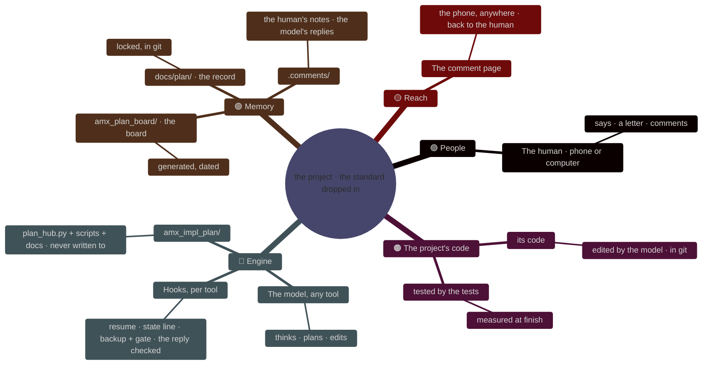
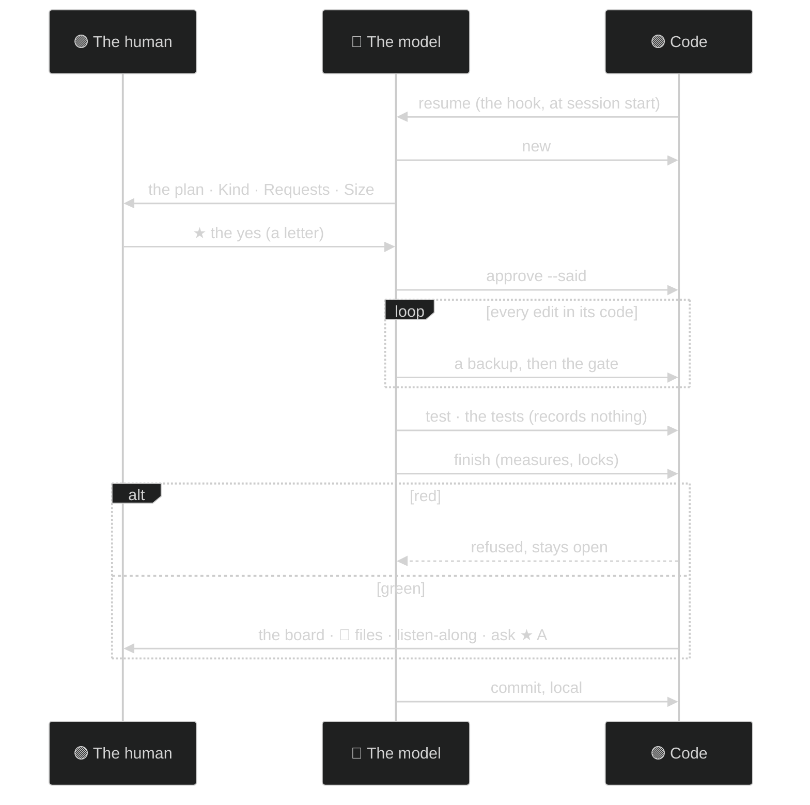
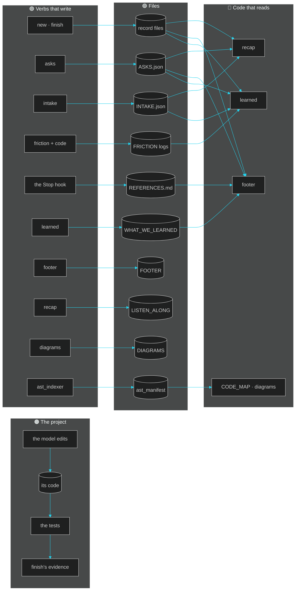
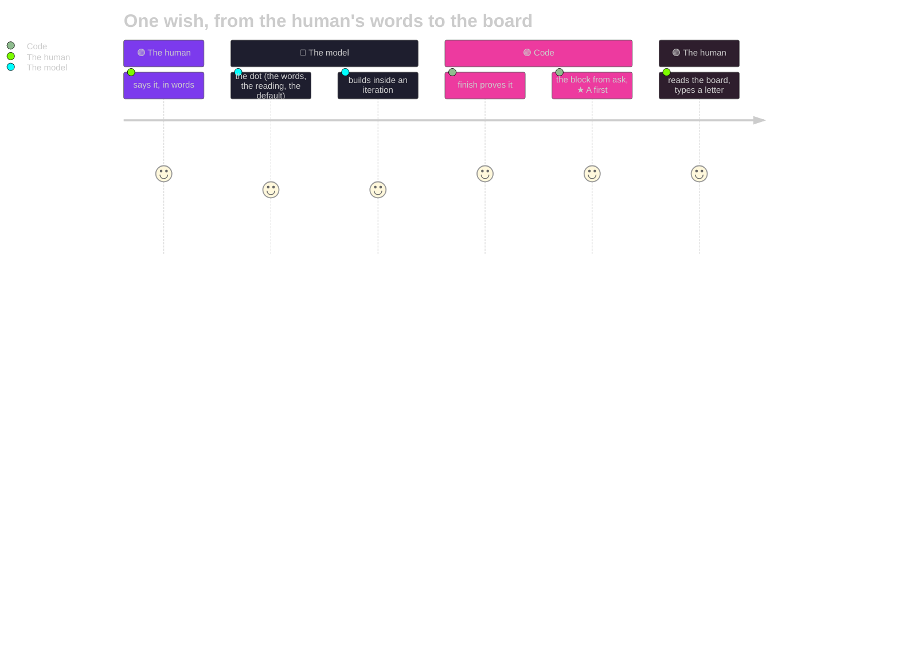

# 13 · The visual structure: where we are and how it works, in pictures
**For:** the human · **By:** Claude Fable 5.1 (for Amit Malhotra) · **Date:** 2026-10-25 · **Record:** iteration v0.1.0 · back to [00_START_HERE](00_START_HERE.md)
*Template for any project: `the pictures` (the system, a session, the data flow, the module tree, the evolution line, the loop; each drawn twice, in text and in Mermaid; how to regenerate them by code) · fills from: `template/diagrams.md` with this project's names, the scripts folder, the evolution doc · 📏 = measured by code · 🧠 = the reviewer's judgement. Only the tree and the timeline are this project's; the sections are the same in every project.*

> 🎧 **In one breath:** Six pictures, and four of them are the standard's, the same in any project. The first shows the parts: a Markdown project with no code of its own, the standard's folder dropped beside it, the record and the board underneath. The second is one session as a loop, and this project's sessions matched it except that commit has nowhere to go. The third is who writes and reads which file, and this project adds only its notes file and its outward set to the flow. The fourth and fifth are empty here, no module tree and no closed version yet; the sixth is the one way in and one way out, which this project used once each.

**The numbers:** 📏 the tree's line counts and the timeline were read at 2026-10-25 14:39; the four fixed drawings carry this project's names, filled by code; every Mermaid block opens with the standard's init line (the dark theme, violet boxes, cyan lines), and the page draws it big (tap for full screen). Under each picture the reviewer adds what a reader should look at in this project.

## (a) The system in one picture
```text
                 THE HUMAN (phone or computer)
                   │ says · approves · comments
                   ▼
   ┌──────────────────────────────┐      ┌───────────────────────────────┐
   │  THE MODEL (any tool)        │◄─────│  HOOKS (per tool)             │
   │  thinks · plans · edits      │      │  session start → Resume block │
   │  runs plan_hub.py verbs          │      │  each message → state line    │
   └───────┬───────────────┬──────┘      │  before edit → backup + gate  │
           │ edits         │ one command │  after reply → refresh        │
           ▼               ▼             └───────────────┬───────────────┘
   ┌──────────────────┐ ┌──────────────────────────────┐ │
   │ THE PROJECT'S    │ │  amx_impl_plan/  (dropped in)   │◄┘
   │ CODE: its code   │ │  plan_hub.py + scripts/          │   never written to; replaced only by an update
   │ tested by        │ │  docs/ (rules, operator)     │
   │ the tests        │ └───────┬──────────────┬───────┘
   └──────────────────┘         │ writes        │ writes
                                ▼               ▼
   ┌───────────────┐  ┌────────────────────────┐   ┌────────────────────┐
   │ docs/plan/   │  │ amx_plan_board/             │   │ .comments/      │
   │ THE RECORD    │  │ THE BOARD (generated)  │   │ the human's notes +│
   │ locked, in git│  │ git-ignored, dated     │   │ the model's replies│
   └───────────────┘  └───────────┬────────────┘   └─────────┬──────────┘
                                  │ served                    │
                                  ▼                           │
                      ┌──────────────────────┐                │
                      │ THE COMMENT PAGE     │◄───────────────┘
                      │ (the phone, anywhere)│ ──► back to THE HUMAN
                      └──────────────────────┘
```

**What to look at:** the project's code is what the model edits and the tests measure; the dropped folder beside it is the standard's only code, and everything under it is either the record (kept) or the board (regenerated). The text drawing shows the arrows; the mind map shows the parts: five branches, and the human on two of them.

**What to look at here:** the "its code" branch is empty in this project; what the model edits and the tests should measure is `DATA_REFERENCES/` and `FINAL_RESUMES/`, Markdown files, and the record's "locked, in git" leaf is wrong here because there is no git.

## (b) One session as a loop
```text
  start ──► [hook] resume ──► new ──► plan written ──► ★ THE HUMAN'S YES ──► approve --said
                                                                                   │
   ┌───────────────────────────────────────────────────────────────────────────────┘
   ▼
  edits in its code (each one: backup hook + gate) ──► test: the tests (nothing recorded) ──► finish (MEASURES)
                                                                            │
                     red: refused, stays open ◄───────────────────────────┤
                                                                            │ green
   commit (local) ◄── board + Listen-along + "Waiting for you" ◄───────────┘
       │
       └──► next message: [hook] state line ──► the next new
```

**What to look at:** there is exactly one place the human's decision enters (★). Everything after it is code measuring the model, not the model reporting on itself. A red finish loops back; it never closes quietly.

**What to look at here:** this project's two sessions followed the picture to the finish and then stopped: "test: the tests" ran nothing, so the close was partial rather than green, and "commit (local)" never happened for want of a repository.

## (c) The data flow: who reads and writes which file
```text
  WRITER (verb)          FILE                                        READERS
  ─────────────          ────                                        ───────
  the model (edits)──►   its code                                   ──► the tests, finish's evidence, the walkthrough
  new / finish     ──►   docs/plan/vX.Y.Z/<Type>_vX.Y.N.md       ──► resume, card, timeline, recap, context
  asks add/done    ──►   docs/plan/<prefix>_ASKS.json            ──► footer, light, recap, learned, triage, dashboard
  intake add       ──►   docs/plan/<prefix>_INTAKE.json          ──► light, recap, learned, digest
  answers (page)   ──►   docs/plan/<prefix>_ANSWERS.jsonl        ──► the state line, the model (taken in)
  code + friction  ──►   vX.Y.Z/<prefix>_FRICTION_vX.Y.Z.md      ──► learned, playbook, triage, close-version
  learned (refresh)──►   <prefix>_WHAT_WE_LEARNED.md              ──► footer (make-or-break), dashboard, the human
  footer (refresh) ──►   amx_plan_board/FOOTER.md                      ──► the state line, the comment page, the human
  recap (refresh)  ──►   amx_plan_board/LISTEN_ALONG.md                ──► the reply after finish, the human
  diagrams (refresh)──►  amx_plan_board/DIAGRAMS.md                    ──► this page, the review's file 13
  ast_indexer      ──►   amx_plan_board/.cache/<tag>/ast_manifest.json ──► CODE_MAP.md, context, this page
```

**What to look at:** every arrow on the right is code reading what code wrote. The model's own words enter only through the record files (its Walkthrough) and the `friction` line it types.

**What to look at here:** this project adds one writer-reader chain of its own: the model writes `DATA_REFERENCES/DEEP_READ_NOTES_2026-10-25.md`, the model reads it to write `FINAL_RESUMES/`, and a scratchpad script reads those to write `FINAL_RESUMES/exports/`; no code reads any of the three today, which is what the outward test will change.

## (d) The module tree (📏 the scripts folder: name · lines)
nothing measured: no code folder found; set code_dirs in amx_plan_config.json

nothing measured: no code folder found; set code_dirs in amx_plan_config.json

**What to look at here:** nothing is measured because no `code_dirs` is set; the biggest file by eye is the dossier, the folder with one job is `FINAL_RESUMES/exports/`, and the only thing to split next is the export script out of the scratchpad and into `scripts/`, after which `code_dirs` can point at it.

## (e) The evolution, on one line (📏 the evolution doc's table)
- no version closed yet

nothing measured

**What to look at here:** there is no line yet, since no version has closed; v0.1.0 so far is one burst in one day, three iterations from the first refused edit to this review, and the bump will write its first point.

## (f) The pure human-in-the-loop loop
```text
        ┌──────────────────── THE HUMAN ───────────────────────┐
        │  intake (what was said)   queries   recommendations  │
        │  new features: the same form, the words recorded     │
        └───────────────┬─────────────────────────▲────────────┘
                        │ one form (intake add)   │ one card (ask): ★ default first
                        ▼                         │
        ┌───────────────────────── THE MODEL ──────────────────┐
        │  reads it back (the dot)  → its default → builds     │
        │  → finish measures → the board, the brief, the link  │
        └──────────────────────────────────────────────────────┘
```

**What to look at:** one way in (the form), one way out (the card). Nothing the human says is acted on without a dot, and nothing is asked without a default. Every piece of it is a verb: `intake add`, `asks add`, `ask --json`, `approve --said`, `finish`.

**What to look at here:** the one way in was the human's sentence "check all the previous model's work for thoroughness", logged as request #1; the one way out is the card on [08](08_DECISIONS.md) asking whether to close it, with the ★ already on yes.

## How to regenerate these by code
| Picture | Can code draw it today? | How |
|---|---|---|
| (a), (b), (c), (f) | yes, twice each 📏 | `template/diagrams.md` with the project's names filled in by `review-folder` and by `plan_hub.py diagrams` (the board's `DIAGRAMS.md`); the text drawing for the phone, the Mermaid one for the page, both with the same names |
| (d) the module tree | yes, twice 📏 | the list from the scripts folder; the Mermaid grouping by folder (`diagrams.tree_mermaid`); on the board, who imports whom from the AST index |
| (e) the timeline | yes, twice 📏 | the evolution doc's "How it grew" table, else the version closes; Mermaid's own timeline (`diagrams.timeline_mermaid`) |
| the "What to look at here" lines | no | the reviewer's, one per picture |

**The chart that tells each story** (the rule for every drawing in this folder): a story in time → `timeline` · one session, who says what to whom → `sequenceDiagram` · the parts of a thing → `mindmap` · a flow with arrows → `flowchart` · the human's path through a loop → `journey` · shares of a whole → `pie` · numbers per run → `xychart-beta` · a plan over time → `gantt`. Never a flowchart for everything.
